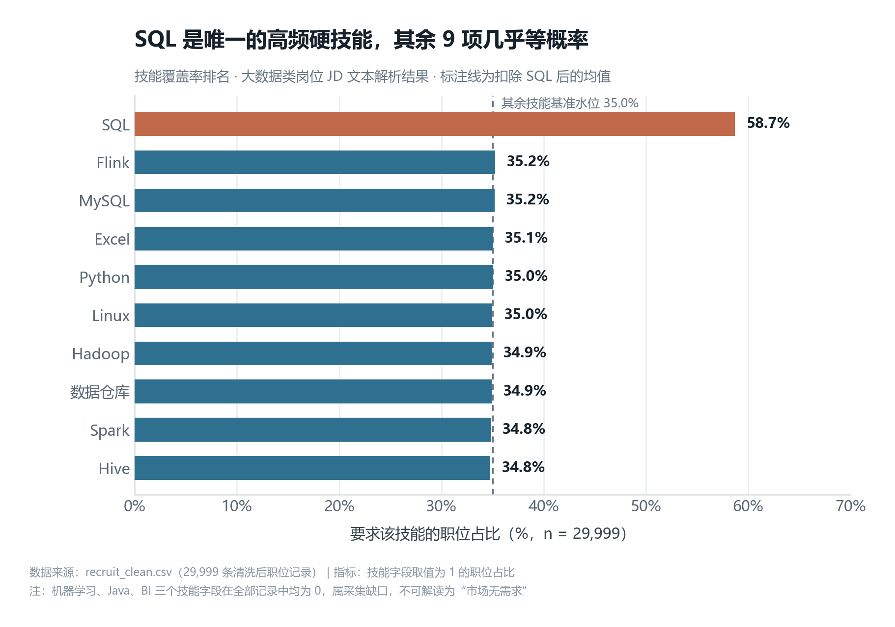
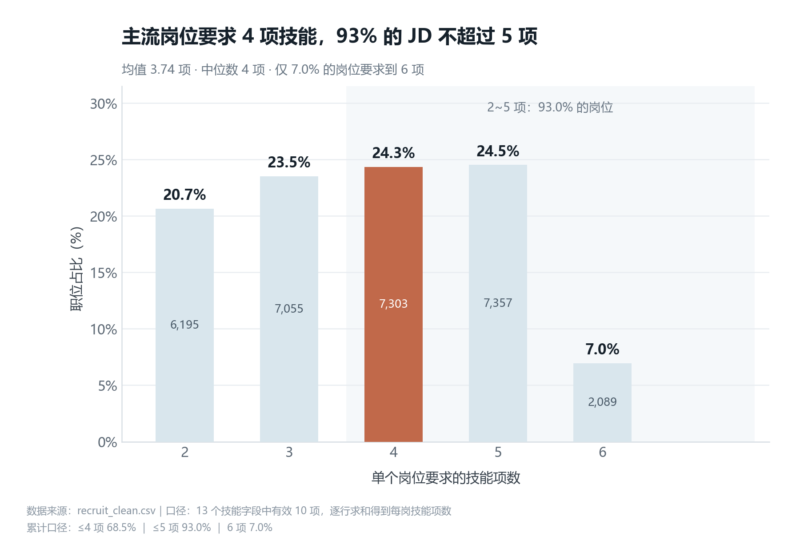
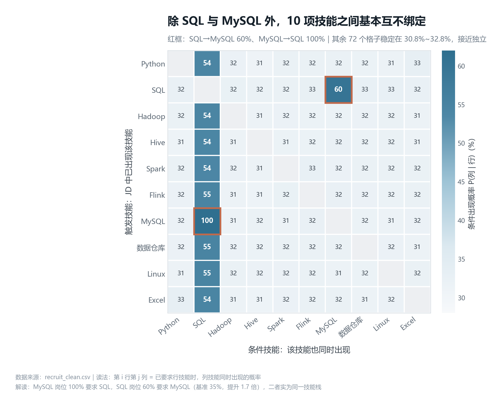
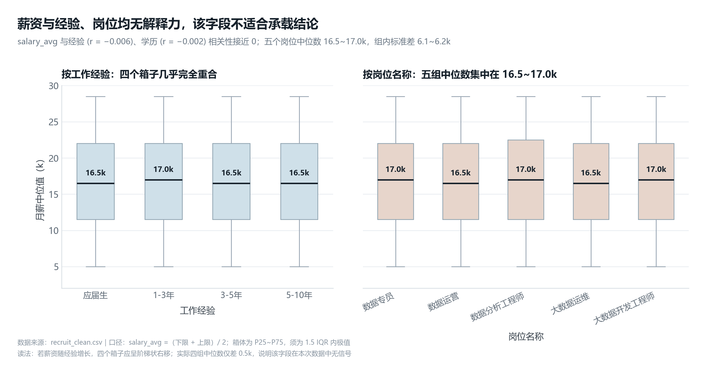

# 大数据招聘岗位数据分析

**用 29,999 条招聘 JD，回答一个问题：投大数据方向，技能栏该写哪几行、写几行。**


> **在线版（GitHub Pages）→ [zhanqing9029.github.io/recruit-analysis](https://zhanqing9029.github.io/recruit-analysis/)**
> **完整报告（六章）→ [index.md](index.md)**
> **A4 PDF（12 页，可随简历附交）→ [recruit-analysis-report.pdf](assets/pdf/recruit-analysis-report.pdf)**

---

## 这个项目在做什么

大三准备实习时，身边同学分别去学 Java、刷 SQL、学推荐算法。我想知道：**这些技能里哪些真的写在招聘要求里，哪些只是互相传的**。凭印象答不了——读完几十条 JD，脑子里只有「好像都要 SQL」，说不出比例，也排不出先后。

所以我把这件事做成了数据问题：采集 12 个城市 × 5 类数据岗位 × 7 个行业的岗位描述，把「要不要某项技能」变成 10 个 0/1 字段，再用覆盖率、分布形态、条件概率、分组对照四步，得出可执行的结论。全流程脚本化，换一份 CSV 就能复跑。

---

## 核心结论

| # | 结论 | 关键数字 |
| :-: | :--- | :--- |
| 1 | **SQL 是唯一的高频硬技能**，断层领先 | 覆盖率 **58.7%**，是第二名（Flink 35.2%）的 **1.67 倍**；其余 9 项挤在 34.8%–35.2% |
| 2 | **单岗技能要求中位数 4 项，5 项封顶** | 中位数 **4**，均值 3.74，**93.0%** 的岗位要求 ≤ 5 项，要求 6 项的仅 7.0% |
| 3 | **技能之间基本不绑定**，唯一强绑定是 SQL ↔ MySQL | MySQL → SQL **100%**，SQL → MySQL **60%**（基准 35%，提升 1.7 倍）；其余 72 格稳定在 30.8%–32.8% |
| 4 | **薪资字段无区分度，不能用来谈薪**（负结果） | 与经验 **r = −0.006**、与学历 **r = −0.002**；四段经验中位数只差 0.5k，五个岗位 16.5–17.0k，组内标准差 6.1–6.2k |

第 4 条是本项目最想强调的部分：**先验证字段，再下结论**。薪资看起来最"有用"，但它在这次数据里没有信号，硬算一个"3–5 年涨薪 12%"很容易，被追问一句就答不上来。所以它没有进入任何业务结论，只作为反例保留在报告里。

---

## 四张图

一条证据链：**学什么 → 学多宽 → 怎么组合 → 可信吗**。

### 图 1 · 技能覆盖率排名（横向条形图）



### 图 2 · 单岗技能项数分布（柱状图 + 区间高亮）



### 图 3 · 技能条件概率矩阵（热力图）



### 图 4 · 薪资分组箱线图（双面板，反例）



---

## 方法与口径

- **样本**：29,999 行 × 27 列（7 个原始字段 + 20 个派生字段），零缺失。12 城市 / 5 类岗位 / 7 行业，2026 年 9 月采集。
- **技能标签**：13 项技能词典（含同义词归一）在 JD 描述上做不区分大小写的正则匹配，命中记 1；其中 3 项（机器学习 / Java / BI）覆盖率为 0，属采集缺口，已在报告中显式标注。
- **薪资**：正则解析区间上下限，统一换算为「k/月」，`salary_avg` =（下限 + 上限）÷ 2，「面议」剔除；异常值按 2–60k 截断。
- **统计**：条件概率 P(列 | 行) 而非共现计数（排除基础率影响）；热力图屏蔽对角线；相关性用 Pearson。
- **质量校验**：记录唯一性、字段完整性、薪资逻辑、薪资分布、技能字段、分类取值，6 项全部通过。

> **一个必须提前说明的约束**：各城市样本量 2,434–2,562、各岗位 5,875–6,074，几乎平均分布——本次采集是**按城市与岗位的配额抽样**。因此本报告不回答"哪个城市机会多""哪类岗位更缺人"，只回答技能结构问题。

---

## 快速开始

```bash
git clone <your-repo-url>
cd recruit-analysis
pip install pandas matplotlib

# 用你自己的招聘数据跑一遍（需含 岗位名称/薪资区间/工作城市/学历要求/工作经验/岗位描述/所属行业 等字段）
python code/recruit_viz.py /path/to/recruit_clean.csv
```

四张图会输出到 `assets/charts/`，200 dpi。脚本内置中文字体设置、配色令牌与逐段注释，把技能词典换成你的行业词表即可复用到其他岗位分析。

---

## 目录结构

```text
recruit-analysis/
├── README.md                     # 仓库说明（本文件）
├── index.md                      # 完整项目报告（六章，GitHub Pages 首页）
├── _config.yml                   # Pages 配置（标题 / 主题）
├── code/
│   └── recruit_viz.py            # 四张图的可复跑脚本（含中文设置与注释）
├── assets/
│   ├── charts/                   # 4 张成图（200 dpi）
│   │   ├── 01_skill_demand.png
│   │   ├── 02_skill_count.png
│   │   ├── 03_skill_cooccurrence.png
│   │   └── 04_salary_check.png
│   └── pdf/
│       └── recruit-analysis-report.pdf   # A4 报告，12 页
```

---

## 已知局限（详见报告第 6 章）

| 级别 | 局限 | 影响 |
| :-: | :--- | :--- |
| P0 | 薪资字段无信号 | 薪资类结论全部不可用 |
| P1 | 机器学习 / Java / BI 三项技能覆盖率为 0 | 只适用于数据分析 / 数据开发方向，不覆盖算法与 BI 岗 |
| P2 | 配额抽样，非自然分布 | 不能回答岗位/城市的机会份额问题 |
| P3 | 技能是 0/1 标签，无熟练度 | 结论只能到"是否要求"这一层 |
| P4 | 单一时间窗口 | 看不到技能需求的趋势变化 |

后续优化按短/中/长期排了 6 条路线（补词典 → 交叉维度 → jieba+TF-IDF → 岗位技能二部图 → 定时更新看板 → 接入真实薪酬校验），见报告 6.3。

---

## 数据说明

原始招聘数据**不随仓库分发**（遵守平台条款，且避免二次传播），仓库只保留聚合后的图表、脚本与报告。若需复现，请用你自己的合规数据源，脚本接口不变。

## 发布为 GitHub Pages

1. 推送本目录到 GitHub 仓库；
2. `Settings → Pages → Source: Deploy from a branch → main / (root)`；
3. 保存后访问 `https://zhanqing9029.github.io/recruit-analysis/`，首页即为 `index.md`（完整报告）。

## License

代码以 MIT 协议开源；报告文字与图表版权归作者所有，转载请注明出处。

## 联系

- GitHub：[@zhanqing9029](https://github.com/zhanqing9029)
- 在线报告：https://zhanqing9029.github.io/recruit-analysis/
- 对分析口径、数据来源有疑问，欢迎在仓库提 Issue。
